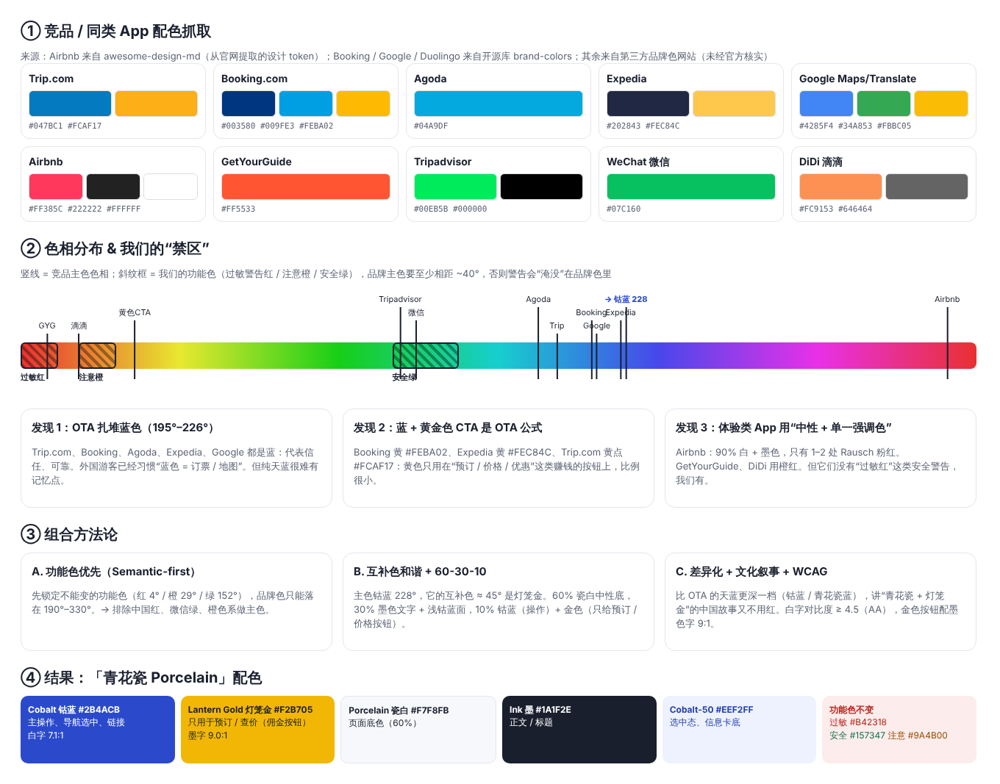

# 配色调研：竞品抓取 → 方法论 → 「青花瓷 Porcelain」

## 1. 竞品 / 同类 App 主色

| 品牌 | 类别 | 颜色 | 色相 | 来源可靠度 |
|---|---|---|---|---|
| Trip.com | OTA | 蓝 #047BC1 · 黄 #FCAF17 | 202° / 40° | 第三方品牌色网站 |
| Booking.com | OTA | 海军蓝 #003580 · 蓝 #009FE3 · 黄 #FEBA02 | 215° / 198° / 44° | brand-colors 开源库 |
| Agoda | OTA | 蓝 #04A9DF | 195° | 第三方 |
| Expedia | OTA | 海军蓝 #202843 · 黄 #FEC84C | 226° / 42° | 第三方（2021 新版） |
| Airbnb | 体验 / 住宿 | Rausch #FF385C，墨 #222222，白底 | 349° | awesome-design-md（从官网提取的设计 token） |
| GetYourGuide | 体验 | 橙红 #FF5533 | 10° | 第三方 |
| Tripadvisor | 点评 | 绿 #00EB5B + 黑 | 143° | 第三方 |
| Google Maps / Translate | 工具 | 蓝 #4285F4 等四色 | 217° | brand-colors 开源库 |
| 微信 WeChat | 在华必备 | 绿 #07C160 | 149° | 第三方 |
| 滴滴 DiDi | 在华必备 | 橙 #FC9153 | 22° | 第三方 |

由于无法访问官网 CSS，Klook、支付宝、高德没有找到可靠色值，所以没有列入。

## 2. 规律
1. **OTA 扎堆蓝色（195°–226°）**：代表信任、可靠。外国游客已经形成“蓝色 = 订票 / 地图”的习惯，但天蓝缺少记忆点。
2. **“蓝 + 金黄 CTA”是 OTA 公式**：黄色只用在预订、价格、优惠这类按钮上，用量很少。
3. **体验类 App 用“中性底 + 单一强调色”**：比如 Airbnb，约 90% 是白和墨色，Rausch 只出现在一两处。

## 3. 方法论
- **功能色优先（Semantic-first）**：本 App 依赖过敏红（4°）、注意橙（29°）、安全绿（152°）。品牌主色要和它们至少相距约 40°，所以只能落在 190°–330°。这排除了中国红、微信绿和橙色系作为主色。
- **互补色和谐 + 60-30-10**：主色钴蓝 228°，它的互补色约 45°，即灯笼金。比例上 60% 瓷白中性底，30% 墨色文字和浅钴蓝面，10% 钴蓝（操作）加金色（只用在预订 / 查价）。
- **差异化 + 文化叙事 + WCAG AA**：比 OTA 的天蓝深一档，讲“青花瓷 + 灯笼金”的中国故事，但不用红色。所有文字对比度 ≥ 4.5:1。

## 4. 结果 Token

| Token | 浅色 | 深色模式 | 用途 | 对比度 |
|---|---|---|---|---|
| `--brand` | #2B4ACB 钴蓝 | #8EA2FF | 主按钮、选中 Tab、链接 | 白字 7.1:1 |
| `--brand-soft` | #EEF2FF | #1E2550 | 选中态、信息卡底 | — |
| `--cta` | #F2B705 灯笼金 | #F2B705 | **只用于**预订 / 查价（佣金链接） | 墨字 9.0:1 |
| `--bg` | #F7F8FB 瓷白 | #12141C | 页面底 | — |
| `--ink` | #1A1F2E 墨 | #EEF0F6 | 正文 | 15.5:1 |
| `--muted` | #5B6273 | #9AA1B2 | 次要文字 | 6.1:1 |
| `--line` | #E3E6EE | #2A2E3B | 分割线 | — |
| `--danger` / `--ok` / `--warn` | #B42318 / #157347 / #9A4B00 | 不变 | 过敏 / 安全 / 注意 | ≥ 5.9:1 |

商业上的好处：金色只给佣金按钮用，“赚钱的按钮”在全 App 里最显眼，而且用户不会把它和警告色混淆。
